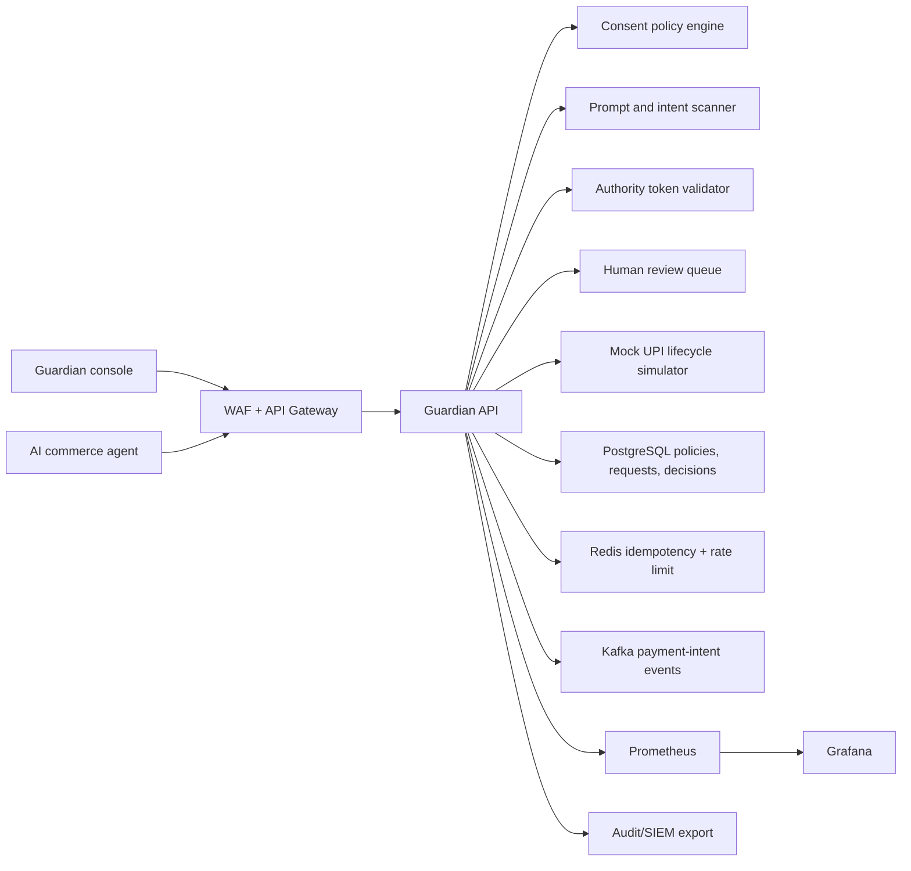
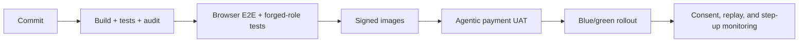

# Enterprise Cloud Deployment

Author: Prashant Jagtap <jprbom@gmail.com>

This repository is a runnable portfolio MVP today. The enterprise target is a consent and authority firewall for autonomous payment agents. It evaluates agent payment intents before simulated UPI approval and decides whether to approve, reject, hold, step up, or send to human review.

## Reference Architecture



## Cloud Mapping

| Layer | AWS | Azure | GCP |
| --- | --- | --- | --- |
| Runtime | EKS/ECS/Fargate | AKS/Container Apps | GKE/Cloud Run |
| Database | RDS PostgreSQL | Azure PostgreSQL | Cloud SQL |
| Events | MSK/SQS | Event Hubs/Service Bus | Pub/Sub |
| Secrets | Secrets Manager/KMS | Key Vault | Secret Manager/KMS |
| Observability | CloudWatch/Grafana | Azure Monitor/Grafana | Cloud Monitoring |

## Production Guardian Differentiators

- Consent object with max amount, category scope, whitelist, expiry, frequency cap, and purpose.
- Prompt-injection and merchant-substitution scanner for agent instructions.
- Signed approval token simulation with replay protection.
- Step-up authentication and human-review queue.
- Revocation workflow and full consent audit trail.

## Required Variables

```text
NODE_ENV=production
PORT=4104
CORS_ORIGIN=https://guardian-mode.example.com
DATABASE_URL=postgresql://...
REDIS_URL=redis://...
KAFKA_BROKERS=broker-1:9092
OIDC_ISSUER=https://issuer.example.com
OIDC_AUDIENCE=upi-guardian-api
CONSENT_SIGNING_KEY_ID=guardian-consent-key
```

## Security Controls

The current app is a demo simulator. Enterprise deployment must validate JWTs, bind every payment intent to tenant/user/agent IDs, require signed consent policies, store immutable audit logs, prevent replayed agent intents, and enforce maker-checker approval for high-risk policy changes.

## Data Model Target

```text
tenants, users, roles, permissions
agents, consent_policies, consent_events
agent_payment_intents, prompt_scan_results
authority_tokens, guardian_decisions
step_up_challenges, human_reviews
decision_reason_codes, model_versions, audit_logs
```

## Deployment Flow



## Observability

Operational endpoints:

- `GET /api/live`
- `GET /api/ready`
- `GET /api/metrics/prometheus`

Dashboards should track decision latency, step-up rate, rejection rate, prompt-injection score distribution, replay attempts, high-risk merchant attempts, policy revocations, RBAC denials, and audit export success.

## Enterprise Readiness Checklist

- Replace JSON persistence with PostgreSQL migrations.
- Add signed consent policy and token verification.
- Add prompt-injection training/evaluation artifacts.
- Add OpenAPI schemas and CI E2E.
- Add SIEM export and incident runbooks for compromised agents.
